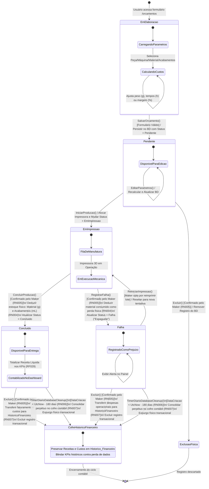
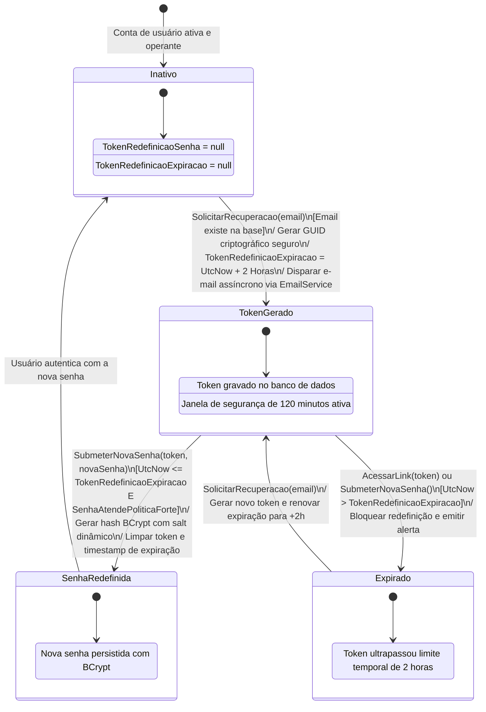
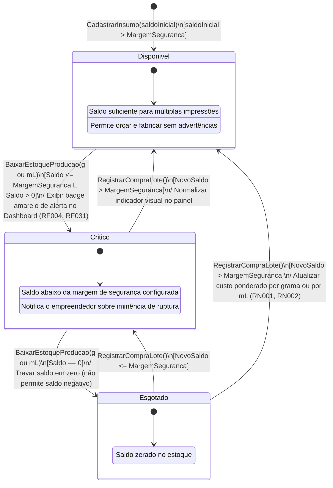

# Especificação Técnica e Diagrama de Máquina de Estados

### Trabalho de Graduação (TG) — Análise e Desenvolvimento de Sistemas (FATEC)
**Aluno:** Felipe Silveira Pessoa  
**Projeto:** LucroImpresso — Sistema de Gestão de Custos, Controle de Estoque e Precificação para Manufatura Aditiva (Impressão 3D)  
**Stack Tecnológica:** C# .NET 9 | ASP.NET Core Blazor Server | Entity Framework Core | MariaDB  

---

## 1. Introdução e Fundamentação Teórica

O **Diagrama de Máquina de Estados** (na especificação OMG UML 2.5, *State Machine Diagram*) é um artefato comportamental essencial da Engenharia de Software voltado a modelar os estados discretos pelos quais um objeto passa durante seu ciclo de vida dentro do sistema, em resposta a eventos internos e externos, bem como as transições, condições de guarda e efeitos colaterais provocados.

No sistema **LucroImpresso**, o ciclo de vida do **Orçamento e da Ordem de Produção (`Orcamento`)** representa o núcleo dinâmico da aplicação, governando:
1. A elaboração matemática e científica dos custos (filamento por grama, insumos químicos por mL e energia elétrica por Watts/kWh);
2. A execução física da impressão 3D e controle da fila de trabalho na oficina maker;
3. O gatilho atômico de dedução física de estoque mediante desfecho com sucesso ou falha operacional de impressão ("espaguete") (`RN004`);
4. A proteção contra exclusões destrutivas (`RN005`);
5. A rotina programada de expurgo de dados inativos após 180 dias (`RN006`) e a salvaguarda perpétua no cofre financeiro acumulador (`RN007`).

Adicionalmente, outros subsistemas vitais contêm comportamentos de estado relevantes: o **Ciclo de Segurança e Expiração de Tokens de Recuperação de Senha** e o **Ciclo de Disponibilidade de Estoque de Insumos**.

---

## 2. Diagrama Principal: Máquina de Estados do Orçamento e Produção

### 2.1 Representação Visual em Mermaid

---

### 2.2 Tabela Formal de Estados da Entidade `Orcamento`

| Identificador do Estado | Nome do Estado | Descrição Semântica e Contexto | Atividades Internas (*entry / do / exit*) |
| :--- | :--- | :--- | :--- |
| **ST01** | `EmElaboracao` | O usuário está na tela de orçamentos inserindo os parâmetros operacionais ou importando dados do fatiador. | **entry /** Carregar listas relacionais de clientes, peças, impressoras, materiais e insumos de acabamento. **do /** Calcular reativamente custos parciais e preço sugerido. **exit /** Validar integridade via `OrcamentoValidator`. |
| **ST02** | `Pendente` | Orçamento gravado no banco de dados com chave do locatário (`UsuarioId`). Aguarda decisão comercial ou alocação na oficina. | **entry /** Habilitar edição completa de campos e exclusão. **do /** Permitir ajustes nos parâmetros de custo e margem. |
| **ST03** | `EmImpressao` | Pedido autorizado e enviado para execução na oficina maker. A impressora 3D selecionada está em processo de fabricação mecânica da peça. | **entry /** Travar alteração de parâmetros de custo para preservar histórico do lote. **do /** Acompanhar tempo decorrido de máquina na fila de produção (`/producao`). |
| **ST04** | `Concluido` | A peça 3D foi impressa com perfeição e o acabamento manual/químico (lixamento, pintura, verniz) foi finalizado com sucesso. | **entry /** Efetuar baixa física atômica de estoque (`RN004`) e disponibilizar valores para apuração de lucro líquido no Dashboard. **do /** Permitir entrega ao cliente e exclusão com preservação contábil. |
| **ST05** | `Falha` | Ocorreu sinistro irrecuperável durante a impressão 3D (descolamento da mesa aquecida, perda de passos, bico entupido ou formação de "espaguete"). | **entry /** Efetuar baixa física do filamento desperdiçado (`RN004`) e registrar custos elétricos da máquina perdida. **do /** Permitir descarte com salvaguarda contábil ou reinicialização da impressão. |
| **ST06** | `CofreHistoricoFinanceiro` | Estado terminal contábil no qual os valores de faturamento e custos são salvaguardados na entidade `HistoricoFinanceiro` e o registro transacional é purgado. | **entry /** Incrementar `ReceitasAcumuladas` e `DespesasEnergiaAcumuladas` no cofre acumulador (`RN007`). **exit /** Executar `DbSet.Remove()` e `SaveChangesAsync()`. |

---

### 2.3 Matriz de Transições de Estados de `Orcamento`

| Estado Origem | Evento / Gatilho (*Trigger*) | Condição de Guarda (*Guard*) | Ação / Efeito (*Action / Effect*) | Estado Destino | Regra de Negócio |
| :--- | :--- | :--- | :--- | :--- | :---: |
| `[*]` | Acesso a `/orcamentos` | Usuário autenticado | Inicializar instância vazia | `EmElaboracao` | `RN008` |
| `EmElaboracao` | `SalvarOrcamento()` | `[OrcamentoValidator.IsValid == true]` | Gravar no banco de dados com `Status = StatusOrcamento.Pendente`. | `Pendente` | `RN008` |
| `Pendente` | `EditarParametros()` | `[DadosValidos == true]` | Recalcular custo total e margem; atualizar registro via `OrcamentoRepository.UpdateAsync()`. | `Pendente` | `RN001`, `RN002`, `RN003` |
| `Pendente` | `IniciarProducao()` | Nenhuma restrição | Atualizar `Status = StatusOrcamento.EmImpressao`. Inserir na fila operacional da oficina. | `EmImpressao` | — |
| `Pendente` | `Excluir()` | `[ConfirmadoEmTela == true]` | Excluir registro do banco sem gerar receitas (não houve produção). | `[*]` (Excluído) | `RN005` |
| `EmImpressao` | `ConcluirProducao()` | `[ConfirmadoEmTela == true]` | **1.** `Material.SaldoGramas -= PesoGramas` **2.** `Acabamento.SaldoMililitros -= QuantidadeMl` **3.** `Status = StatusOrcamento.Concluido` **4.** Gravar alterações atômicas no banco. | `Concluido` | `RN004`, `RN005` |
| `EmImpressao` | `RegistrarFalha()` | `[ConfirmadoEmTela == true]` | **1.** `Material.SaldoGramas -= PesoGramas` **2.** `Acabamento.SaldoMililitros -= QuantidadeMl` **3.** `Status = StatusOrcamento.Falha` **4.** Registrar perda contábil. | `Falha` | `RN004`, `RN005` |
| `Falha` | `ReiniciarImpressao()` | Maker opta por reimprimir lote | Atualizar `Status = StatusOrcamento.EmImpressao`. Retornar para fila da impressora. | `EmImpressao` | — |
| `Concluido` | `ExcluirManual()` | `[ConfirmadoEmTela == true]` | **1.** `HistoricoFinanceiro.ReceitasAcumuladas += CustoFinal` **2.** `HistoricoFinanceiro.DespesasEnergiaAcumuladas += CustoEnergia` **3.** Remover da tabela `Orcamento`. | `CofreHistoricoFinanceiro` | `RN005`, `RN007` |
| `Falha` | `ExcluirManual()` | `[ConfirmadoEmTela == true]` | **1.** `HistoricoFinanceiro.DespesasEnergiaAcumuladas += CustoEnergia` **2.** Remover da tabela `Orcamento`. | `CofreHistoricoFinanceiro` | `RN005`, `RN007` |
| `Concluido` | `TimerDiarioExpurgo()` | `[DataCriacao < UtcNow - 180 dias]` | Execução por `DatabaseCleanupService`. Transferir receita para `HistoricoFinanceiro` e expurgar. | `CofreHistoricoFinanceiro` | `RN006`, `RN007` |
| `Falha` | `TimerDiarioExpurgo()` | `[DataCriacao < UtcNow - 180 dias]` | Execução por `DatabaseCleanupService`. Transferir despesas de perda para `HistoricoFinanceiro` e expurgar. | `CofreHistoricoFinanceiro` | `RN006`, `RN007` |

---

## 3. Diagramas Complementares de Máquinas de Estado

### 3.1 Ciclo de Vida do Token de Recuperação de Senha (`Usuario`)

Este diagrama detalha o comportamento dos campos de segurança `TokenRedefinicaoSenha` e `TokenRedefinicaoExpiracao` mapeados na entidade `Usuario` (`RF034`, `RF035`, `RNF002`).

---

### 3.2 Ciclo de Estados de Inventário e Nível de Estoque (`Material` / `Acabamento`)

Mapeia a transição dos insumos de produção (filamentos, resinas, primers, tintas e solventes) frente ao consumo fabril e reposição (`RF001` a `RF006`, `RN001`, `RN002`, `RN004`).

---

## 4. Mapeamento e Rastreabilidade no Código-Fonte (.NET 9 / C#)

A tabela abaixo estabelece a ponte formal de rastreabilidade entre as transições de estados especificadas na modelagem UML e a respectiva implementação no código-fonte do sistema:

| Transição de Estado | Camada de Implementação | Arquivo de Código / Método | Regra Aplicada |
| :--- | :--- | :--- | :---: |
| `[*] -> EmElaboracao -> Pendente` | Visão Blazor / Repositório | `Components/Pages/Orcamentos/Orcamentos.razor` `Repositories/OrcamentoRepository.cs` (`AddAsync`) | `RN008` |
| `Pendente -> EmImpressao` | Visão Blazor / Repositório | `Components/Pages/Producao/Producao.razor` (`MudarStatus`) | — |
| `EmImpressao -> Concluido` | Visão Blazor / Repositórios | `Components/Pages/Producao/Producao.razor` (`FinalizarProducao(true)`) `MaterialRepository.cs` `AcabamentoRepository.cs` | `RN004`, `RN005` |
| `EmImpressao -> Falha` | Visão Blazor / Repositórios | `Components/Pages/Producao/Producao.razor` (`FinalizarProducao(false)`) | `RN004`, `RN005` |
| `Concluido -> CofreHistorico` | Repositório | `Repositories/OrcamentoRepository.cs` (`DeleteAsync`) | `RN005`, `RN007` |
| `Falha -> CofreHistorico` | Repositório | `Repositories/OrcamentoRepository.cs` (`DeleteAsync`) | `RN005`, `RN007` |
| `Expurgo Diário (180 dias)` | Serviço de Segundo Plano / Repositório | `Services/DatabaseCleanupService.cs` (`DoCleanup`) `Repositories/OrcamentoRepository.cs` (`DeleteAntigosAsync`) | `RN006`, `RN007` |
| `Token: Inativo -> Gerado -> Consumido` | Serviços / Repositório | `Services/EmailService.cs` `Repositories/UsuarioRepository.cs` `Components/Pages/Login/RedefinirSenha.razor` | `RF034`, `RF035`, `RNF002` |

---

## 5. Formalização Arquitetural: `OrcamentoStateMachine`

Para garantir desacoplamento, testabilidade unitária e aderência aos princípios do SOLID (*Single Responsibility Principle* e *Open/Closed Principle*), a lógica de validação de transições de estado, condições de guarda e efeitos colaterais de estoque está encapsulada no serviço de domínio `OrcamentoStateMachine.cs` (`src/LucroImpresso.Web/Services/OrcamentoStateMachine.cs`), permitindo que a camada Blazor e os serviços de background invoquem transições protegidas por regras de validação estritas.
