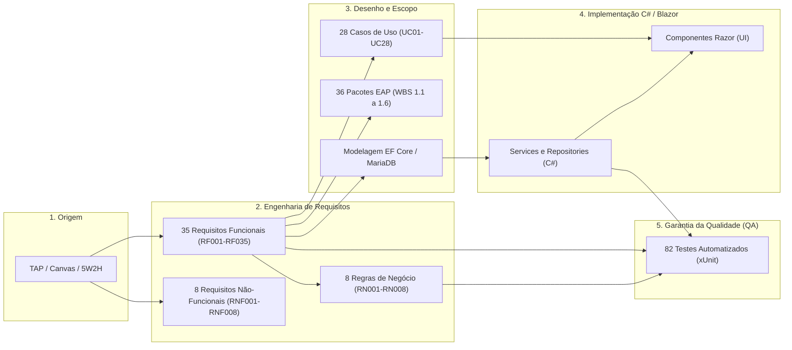

# Matriz de Rastreabilidade de Requisitos (RTM) — Sistema LucroImpresso

**Projeto:** LucroImpresso — Sistema Especializado em Gestão de Custos e Precificação para Impressão 3D  
**Trabalho de Graduação (TG):** Faculdade de Tecnologia do Estado de São Paulo (FATEC)  
**Curso:** Curso Superior de Tecnologia em Análise e Desenvolvimento de Sistemas  
**Aluno:** Felipe Silveira Pessoa  
**Padrões Normativos:** ISO/IEC/IEEE 29148:2018 (Requirements Engineering) e ISO/IEC 25010 (SQuaRE)  
**Versão do Documento:** 3.0 (Alinhada ao .NET 9, Blazor Server, EF Core 9, MariaDB e Design Neo-Brutalista)  
**Data:** 25 de Setembro de 2026  

---

## 1. Introdução e Metodologia de Rastreabilidade

A **Matriz de Rastreabilidade de Requisitos (Requirements Traceability Matrix - RTM)** é o instrumento basilar da Engenharia de Software responsável por estabelecer, documentar e auditar os vínculos bidirecionais entre as necessidades estratégicas do negócio, a especificação técnica de requisitos, a arquitetura de dados, o código-fonte executável e os artefatos de validação e garantia da qualidade (QA).

### 1.1. Objetivos Acadêmicos e Metodológicos (FATEC)
1. **Garantia de Cobertura Total (*Forward Traceability*):** Assegurar que 100% dos requisitos funcionais (RF001 a RF035) e não funcionais (RNF001 a RNF008) elicitados foram devidamente projetados em Casos de Uso (UML), decompostos na Estrutura Analítica do Projeto (EAP / WBS), codificados nas camadas de software e validados por suíte de testes automatizados.
2. **Prevenção de Escopo Fantasma (*Backward Traceability*):** Demonstrar que cada tabela do banco de dados, repositório C#, serviço de domínio e componente de interface do sistema LucroImpresso possui uma justificativa legítima originada nos requisitos de negócio, impedindo a ocorrência de *gold plating*.
3. **Auditoria da Banca Avaliadora:** Fornecer aos docentes avaliadores um mapa transparente e navegável que correlacione as 8 Regras de Negócio (`RN001` a `RN008`), os 28 Casos de Uso (`UC01` a `UC28`), os componentes Blazor, os repositórios EF Core e os 82 testes unitários aprovados (`dotnet test`).

---

## 2. Estrutura e Convenções da RTM

| Dimensão de Rastreabilidade | Código / Prefixo | Significado na Arquitetura do LucroImpresso |
| :--- | :---: | :--- |
| **Requisito Funcional** | `RF001` a `RF035` | Capacidades e operações executáveis pelo sistema para o usuário maker. |
| **Requisito Não Funcional** | `RNF001` a `RNF008` | Restrições técnicas, desempenho, segurança, custo e arquitetura de software. |
| **Regra de Negócio** | `RN001` a `RN008` | Políticas mandatórias e fórmulas matemáticas de precificação e governança de dados. |
| **Caso de Uso UML** | `UC01` a `UC28` | Atores e cenários de interação modelados no diagrama de casos de uso do sistema. |
| **Pacote de Trabalho da EAP** | `WBS 1.1` a `1.6` | Decomposição hierárquica do ciclo de vida acadêmico e de engenharia. |
| **Entidade de Domínio** | Classes EF Core | Modelos relacionais mapeados (`Material`, `Acabamento`, `Maquina`, `Orcamento`, etc.). |
| **Interface com Usuário** | Páginas `.razor` | Componentes visuais reativos Blazor Server com Design Neo-Brutalista. |
| **Camada de Negócio / Dados** | Classes C# | Repositórios desacoplados (`IRepository`) e Serviços de domínio (`Services/`). |
| **Validação / Teste Unitário** | Classes xUnit | Suíte automatizada em `tests/LucroImpresso.Tests` com 82 testes aprovados. |
| **Status de Conformidade** | `IMPLEMENTADO` | Requisito 100% construído, integrado e homologado em testes unitários. |

---

## 3. Matriz de Rastreabilidade dos Requisitos Funcionais (RF001 a RF035)

### 3.1. Módulo 1: Gestão de Matérias-Primas e Insumos de Acabamento (RF001 a RF006)

| ID | Requisito Funcional | Prior. | Regra Negócio | Caso de Uso | Pacote EAP | Entidade / BD | Interface (UI) | Camada C# / Serviço | Teste de Validação (xUnit) | Status |
| :---: | :--- | :---: | :---: | :---: | :---: | :--- | :--- | :--- | :--- | :---: |
| **RF001** | Cadastrar matérias-primas (filamentos e resinas) com nome, marca, cor, tipo, peso (g) e valor (R$). | Alta | RN001 | UC15 | 1.4.7 | `Material` | `MaterialPage.razor` | `MaterialRepository.cs` | `MaterialValidator_SaldoMaiorQuePesoRolo_DeveFalhar` | IMPLEMENTADO |
| **RF002** | Cadastrar insumos de acabamento (tintas, primers, vernizes, solventes) com categoria, cor, volume (mL) e valor (R$). | Alta | RN002 | UC16 | 1.4.8 | `Acabamento` | `AcabamentoPage.razor` | `AcabamentoRepository.cs` | `AcabamentoValidator_TiposValidos_DevePassar`, `AcabamentoValidator_TipoVazio_DeveFalhar` | IMPLEMENTADO |
| **RF003** | Consultar inventário em tempo real, exibindo saldos em gramas e mililitros. | Alta | RN001, RN002 | UC17 | 1.4.7, 1.4.8 | `Material`, `Acabamento` | `MaterialPage.razor`, `AcabamentoPage.razor` | `MaterialRepository.cs`, `AcabamentoRepository.cs` | `MultiTenantEInfraTests.cs` (Isolamento de inventário) | IMPLEMENTADO |
| **RF004** | Exibir alerta visual em destaque na interface caso o saldo de filamento ou acabamento esteja abaixo da margem crítica. | Média | — | UC17, UC20 | 1.4.7, 1.4.8 | `Material`, `Acabamento` | `Dashboard.razor`, `MaterialPage.razor`, `AcabamentoPage.razor` | `MaterialRepository.cs`, `AcabamentoRepository.cs` | `OrcamentoStateMachineTests.ExigeConfirmacaoExplicita` | IMPLEMENTADO |
| **RF005** | Permitir edição e atualização dos dados cadastrais de materiais e insumos. | Alta | RN001, RN002 | UC18 | 1.4.7, 1.4.8 | `Material`, `Acabamento` | `MaterialPage.razor`, `AcabamentoPage.razor` | `MaterialRepository.cs`, `AcabamentoRepository.cs` | `AcabamentoValidator_SaldoMaiorQueVolumeOriginal_DeveFalhar` | IMPLEMENTADO |
| **RF006** | Permitir exclusão manual de materiais ou insumos mediante confirmação explícita em modal. | Baixa | RN005 | UC18 | 1.4.7, 1.4.8 | `Material`, `Acabamento` | `MaterialPage.razor`, `AcabamentoPage.razor` | `MaterialRepository.cs`, `AcabamentoRepository.cs` | `OrcamentoStateMachineTests.ExigeConfirmacaoExplicita_StatusCriticos_DeveValidarRN005` | IMPLEMENTADO |

---

### 3.2. Módulo 2: Motor de Orçamentos e Precificação Científica (RF007 a RF014)

| ID | Requisito Funcional | Prior. | Regra Negócio | Caso de Uso | Pacote EAP | Entidade / BD | Interface (UI) | Camada C# / Serviço | Teste de Validação (xUnit) | Status |
| :---: | :--- | :---: | :---: | :---: | :---: | :--- | :--- | :--- | :--- | :---: |
| **RF007** | Gerar orçamentos com dados técnicos do fatiador (peso em g e tempo em HH:MM) ou via catálogo de peças. | Alta | RN001, RN003 | UC19 | 1.4.9 | `Orcamento`, `Peca` | `Orcamentos.razor` | `OrcamentoRepository.cs`, `OrcamentoStateMachine.cs` | `OrcamentoValidator_DadosValidos_DevePassar`, `OrcamentoValidator_PesoInvalido_DeveFalhar` | IMPLEMENTADO |
| **RF008** | Inclusão opcional de múltiplos insumos de acabamento dosados em mL no orçamento. | Alta | RN002 | UC19 | 1.4.9 | `OrcamentoAcabamento`, `Acabamento` | `Orcamentos.razor` | `OrcamentoRepository.cs`, `OrcamentoStateMachine.cs` | `TransitarParaConcluido_DeveDeduzirEstoqueFisicoENaoPermitirSaldoNegativo` | IMPLEMENTADO |
| **RF009** | Registrar tempo de acabamento manual (HH:MM) e calcular custo via taxa horária de acabamento. | Alta | RN002 | UC19 | 1.4.9 | `Orcamento` | `Orcamentos.razor` | `OrcamentoRepository.cs` | `OrcamentoValidator_TempoImpressaoInvalido_DeveFalhar` | IMPLEMENTADO |
| **RF010** | Calcular automaticamente o custo de energia elétrica consumida (Watts, tempo em horas e tarifa kWh). | Alta | RN003 | UC19 | 1.4.9 | `Orcamento`, `Maquina` | `Orcamentos.razor` | `OrcamentoRepository.cs` | `MaquinaValidator_ValoresNegativos_DevemFalhar` | IMPLEMENTADO |
| **RF011** | Bloquear a criação de orçamentos quando materiais ou insumos de acabamento possuam saldo insuficiente, exibindo mensagem de erro. | Alta | — | UC20 | 1.4.9 | `Orcamento`, `Material`, `Acabamento` | `Orcamentos.razor` | `OrcamentoRepository.cs`, `OrcamentoStateMachine.cs` | `PodeTransitar_TransicoesValidas_DevemRetornarTrue` | IMPLEMENTADO |
| **RF012** | Calcular o preço de venda sugerido somando custos diretos e margem de lucro real sobre a mão de obra. | Alta | RN001, RN002, RN003 | UC19 | 1.4.9 | `Orcamento` | `Orcamentos.razor` | `OrcamentoRepository.cs` | `OrcamentoValidator_DadosValidos_DevePassar` | IMPLEMENTADO |
| **RF013** | Salvar o orçamento no banco com status inicial "Pendente" atrelado ao tenant. | Alta | RN008 | UC19 | 1.4.9 | `Orcamento` | `Orcamentos.razor` | `OrcamentoRepository.cs`, `OrcamentoStateMachine.cs` | `TransitarParaImpressao_DePendente_DeveAlterarStatusComSucesso` | IMPLEMENTADO |
| **RF014** | Permitir consulta detalhada, edição e exclusão de orçamentos com validação de segurança. | Alta | RN005, RN007, RN008 | UC21, UC22 | 1.4.9 | `Orcamento`, `HistoricoFinanceiro` | `Orcamentos.razor` | `OrcamentoRepository.cs`, `HistoricoFinanceiroRepository.cs` | `MultiTenantEInfraTests.Models_CamposTextoCriticos_DevemPossuirAtributoMaxLength` | IMPLEMENTADO |

---

### 3.3. Módulo 3: Fila de Produção, Baixa de Estoque e Falhas (RF015 a RF018)

| ID | Requisito Funcional | Prior. | Regra Negócio | Caso de Uso | Pacote EAP | Entidade / BD | Interface (UI) | Camada C# / Serviço | Teste de Validação (xUnit) | Status |
| :---: | :--- | :---: | :---: | :---: | :---: | :--- | :--- | :--- | :--- | :---: |
| **RF015** | Permitir transição do status do orçamento para "Pendente", "Em Impressão", "Concluído" ou "Falha". | Alta | RN004 | UC23 | 1.4.10 | `Orcamento` | `Producao.razor`, `Orcamentos.razor` | `OrcamentoStateMachine.cs`, `OrcamentoRepository.cs` | `PodeTransitar_TransicoesValidas_DevemRetornarTrue`, `PodeTransitar_TransicoesInvalidas_DevemRetornarFalse` | IMPLEMENTADO |
| **RF016** | Registrar "Falha de Impressão" (espaguete/descolamento), contabilizando perdas físicas de material e energia. | Média | RN004 | UC25 | 1.4.10 | `Orcamento`, `Material` | `Producao.razor` | `OrcamentoStateMachine.cs`, `OrcamentoRepository.cs` | `TransitarParaFalha_DeveDeduzirMaterialConsumido` | IMPLEMENTADO |
| **RF017** | Deduzir automaticamente estoque de materiais (g) e acabamentos (mL) estritamente em "Concluído" ou "Falha". | Alta | RN004 | UC26 | 1.4.10 | `Material`, `Acabamento`, `Orcamento` | `Producao.razor` | `OrcamentoStateMachine.cs`, `OrcamentoRepository.cs` | `TransitarParaConcluido_DeveDeduzirEstoqueFisicoENaoPermitirSaldoNegativo` | IMPLEMENTADO |
| **RF018** | Disponibilizar painel visual da fila de produção para acompanhamento do fluxo de manufatura aditiva. | Alta | RN004, RN008 | UC23 | 1.4.10 | `Orcamento` | `Producao.razor` | `OrcamentoRepository.cs` | `OrcamentoStateMachineTests.cs` | IMPLEMENTADO |

---

### 3.4. Módulo 4: Rotinas em Background e Ciclo de Vida de Dados (RF019 a RF020)

| ID | Requisito Funcional | Prior. | Regra Negócio | Caso de Uso | Pacote EAP | Entidade / BD | Interface (UI) | Camada C# / Serviço | Teste de Validação (xUnit) | Status |
| :---: | :--- | :---: | :---: | :---: | :---: | :--- | :--- | :--- | :--- | :---: |
| **RF019** | Varrer periodicamente o banco em background para expurgar orçamentos inativos há mais de 180 dias. | Baixa | RN006 | UC28 | 1.4.12 | `Orcamento` | N/A (Background Service) | `DatabaseCleanupService.cs`, `OrcamentoStateMachine.cs` | `PodeSerExpurgado_AbaixoDe180Dias_DeveRetornarFalse`, `PodeSerExpurgado_AcimaDe180Dias_DeveRetornarTrue` | IMPLEMENTADO |
| **RF020** | Consolidar valores contábeis no cofre acumulador `HistoricoFinanceiro` ao expurgar ou excluir orçamentos. | Alta | RN007 | UC22, UC28 | 1.4.11, 1.4.12 | `HistoricoFinanceiro`, `Orcamento` | `Dashboard.razor` | `HistoricoFinanceiroRepository.cs`, `DatabaseCleanupService.cs` | `MultiTenantEInfraTests.Models_NovasInstancias_DevemInicializarComDataUtc` | IMPLEMENTADO |

---

### 3.5. Módulo 5: Gestão de Clientes e Validações Cadastrais (RF021 a RF024)

| ID | Requisito Funcional | Prior. | Regra Negócio | Caso de Uso | Pacote EAP | Entidade / BD | Interface (UI) | Camada C# / Serviço | Teste de Validação (xUnit) | Status |
| :---: | :--- | :---: | :---: | :---: | :---: | :--- | :--- | :--- | :--- | :---: |
| **RF021** | Cadastrar clientes segregando Pessoa Física (CPF/Nome) e Pessoa Jurídica (CNPJ/Razão Social) com regra disjunta (XT). | Alta | RN008 | UC12 | 1.4.4 | `Cliente`, `PessoaFisica`, `PessoaJuridica` | `ClientePage.razor` | `ClienteRepository.cs` | `ClienteValidator_SomentePessoaFisica_DevePassar`, `ClienteValidator_SomentePessoaJuridica_DevePassar`, `ClienteValidator_AmbosPF_E_PJ_DeveFalharRegraXT` | IMPLEMENTADO |
| **RF022** | Validar integridade e formato de CPF e CNPJ em tempo real, impedindo cadastros inválidos ou duplicados. | Alta | RN008 | UC12 | 1.4.4 | `PessoaFisica`, `PessoaJuridica` | `ClientePage.razor` | `ClienteValidator.cs`, `ClienteRepository.cs` | `ClienteValidator_NenhumPF_Nem_PJ_DeveFalharRegraXT` | IMPLEMENTADO |
| **RF023** | Registrar informações completas de contato (celular formatado) e endereço com máscara. | Alta | RN008 | UC12 | 1.4.4 | `Cliente`, `Endereco` | `ClientePage.razor` | `ClienteRepository.cs`, `ClienteValidator.cs` | `ClienteValidator_CelularFormatoInvalido_DeveFalhar` | IMPLEMENTADO |
| **RF024** | Listagem, busca, edição e exclusão de clientes com diálogo de confirmação. | Média | RN005, RN008 | UC13, UC14 | 1.4.4 | `Cliente` | `ClientePage.razor` | `ClienteRepository.cs` | `MultiTenantEInfraTests.Models_NovasInstancias_DevemInicializarComDataUtc` | IMPLEMENTADO |

---

### 3.6. Módulo 6: Parque de Máquinas e Energia (RF025 a RF026)

| ID | Requisito Funcional | Prior. | Regra Negócio | Caso de Uso | Pacote EAP | Entidade / BD | Interface (UI) | Camada C# / Serviço | Teste de Validação (xUnit) | Status |
| :---: | :--- | :---: | :---: | :---: | :---: | :--- | :--- | :--- | :--- | :---: |
| **RF025** | Cadastro de impressoras 3D (CRUD) registrando identificação, consumo (Watts) e tarifa de kWh. | Alta | RN003, RN008 | UC09, UC10, UC11 | 1.4.6 | `Maquina` | `MaquinaPage.razor` | `MaquinaRepository.cs` | `MaquinaValidator_ValoresNegativos_DevemFalhar` | IMPLEMENTADO |
| **RF026** | Injeção automática dos parâmetros de potência (Watts) e tarifa de kWh da impressora nos cálculos de energia do orçamento. | Alta | RN003 | UC19 | 1.4.6, 1.4.9 | `Maquina`, `Orcamento` | `Orcamentos.razor` | `OrcamentoRepository.cs`, `MaquinaRepository.cs` | `OrcamentoValidator_FksAusentes_DevemFalhar` | IMPLEMENTADO |

---

### 3.7. Módulo 7: Catálogo de Peças 3D e Modelos STL (RF027 a RF028)

| ID | Requisito Funcional | Prior. | Regra Negócio | Caso de Uso | Pacote EAP | Entidade / BD | Interface (UI) | Camada C# / Serviço | Teste de Validação (xUnit) | Status |
| :---: | :--- | :---: | :---: | :---: | :---: | :--- | :--- | :--- | :--- | :---: |
| **RF027** | Cadastro de peças recorrentes com nome, peso estimado (g), tempo de impressão e link de arquivo STL com proteção anti-XSS. | Média | RN008 | UC06, UC07, UC08 | 1.4.5 | `Peca` | `PecaPage.razor` | `PecaRepository.cs` | `PecaValidator_LinksNaoHttpOuHttps_DevemSerRejeitados`, `PecaValidator_LinksValidosOuVazios_DevemPassar`, `PecaValidator_NomePecaVazioOuMuitoLongo_DeveFalhar` | IMPLEMENTADO |
| **RF028** | Carregamento automático dos parâmetros técnicos da peça (peso e tempo) no formulário de elaboração de orçamentos. | Média | RN001 | UC19 | 1.4.5, 1.4.9 | `Peca`, `Orcamento` | `Orcamentos.razor` | `PecaRepository.cs`, `OrcamentoRepository.cs` | `OrcamentoValidator_DadosValidos_DevePassar` | IMPLEMENTADO |

---

### 3.8. Módulo 8: Dashboard Operacional e Gestão Financeira (RF029 a RF031)

| ID | Requisito Funcional | Prior. | Regra Negócio | Caso de Uso | Pacote EAP | Entidade / BD | Interface (UI) | Camada C# / Serviço | Teste de Validação (xUnit) | Status |
| :---: | :--- | :---: | :---: | :---: | :---: | :--- | :--- | :--- | :--- | :---: |
| **RF029** | Exibir Dashboard analítico com KPIs de Faturamento, Lucro Líquido Real, Total de Pedidos e status operacional. | Alta | RN007, RN008 | UC27 | 1.4.11 | `Orcamento`, `HistoricoFinanceiro` | `Dashboard.razor` | `HistoricoFinanceiroRepository.cs`, `OrcamentoRepository.cs` | `MultiTenantEInfraTests.cs` | IMPLEMENTADO |
| **RF030** | Totalização contínua somando orçamentos ativos e valores históricos consolidados no cofre acumulador. | Alta | RN007 | UC27 | 1.4.11 | `HistoricoFinanceiro`, `Orcamento` | `Dashboard.razor` | `HistoricoFinanceiroRepository.cs` | `MultiTenantEInfraTests.Models_NovasInstancias_DevemInicializarComDataUtc` | IMPLEMENTADO |
| **RF031** | Exibir alertas visuais no painel inicial indicando estoques de filamento e acabamento em nível crítico. | Média | — | UC17, UC27 | 1.4.11 | `Material`, `Acabamento` | `Dashboard.razor` | `MaterialRepository.cs`, `AcabamentoRepository.cs` | `OrcamentoStateMachineTests.ExigeConfirmacaoExplicita` | IMPLEMENTADO |

---

### 3.9. Módulo 9: Autenticação, Identidade e Segurança (RF032 a RF035)

| ID | Requisito Funcional | Prior. | Regra Negócio | Caso de Uso | Pacote EAP | Entidade / BD | Interface (UI) | Camada C# / Serviço | Teste de Validação (xUnit) | Status |
| :---: | :--- | :---: | :---: | :---: | :---: | :--- | :--- | :--- | :--- | :---: |
| **RF032** | Autenticação no sistema (Login) com validação de credenciais via Cookies seguros e Claims do usuário. | Alta | RN008 | UC01 | 1.4.2 | `Usuario` | `Login.razor` | `UsuarioRepository.cs` | `SegurancaAutenticacaoTests.ValidarForcaSenha_SenhasFortes_DevemPassar`, `BCrypt_HashEVerificacao_DeveFuncionarComSaltSeguro` | IMPLEMENTADO |
| **RF033** | Registro de novas contas (Sign-up) com validação de unicidade de e-mail e regras de senha forte. | Alta | RN008 | UC04 | 1.4.2 | `Usuario` | `Cadastro.razor` | `UsuarioRepository.cs` | `SegurancaAutenticacaoTests.ValidarForcaSenha_SenhasFracas_DevemRetornarErro` | IMPLEMENTADO |
| **RF034** | Recuperação de senha por e-mail com geração de token criptográfico de alta entropia válido por 2 horas. | Média | RN008 | UC05 | 1.4.3 | `PasswordResetToken`, `Usuario` | `EsqueciSenha.razor`, `RedefinirSenha.razor` | `UsuarioRepository.cs`, `EmailService.cs` | `SegurancaAutenticacaoTests.GeracaoTokenCriptografico_DeveTerAltaEntropiaEFormatoValido`, `EmailService_EmProducao_NaoDeveExporUltimoLinkDev` | IMPLEMENTADO |
| **RF035** | Encerramento de sessão ativa (Logout) com revogação imediata de credenciais e limpeza de cookies. | Média | RN008 | UC01 | 1.4.2 | `Usuario` | `NavMenu.razor` | `UsuarioRepository.cs` | `SegurancaAutenticacaoTests.cs` | IMPLEMENTADO |

---

## 4. Matriz de Rastreabilidade dos Requisitos Não-Funcionais (RNF001 a RNF008)

| ID | Requisito Não Funcional | Categoria | Padrão / Norma | Componente Arquitetural C# | Mecanismo de Garantia no Software | Verificação e Evidência de QA | Status |
| :---: | :--- | :---: | :---: | :--- | :--- | :--- | :---: |
| **RNF001** | Stack C# 13, .NET 9 e Blazor Interactive Server | Portabilidade e Desempenho | ISO/IEC 25010 (Adaptabilidade) | `Program.cs`, `LucroImpresso.Web.csproj` | Renderização reativa de DOM via WebSockets nativos (SignalR) sem recarregar a página. | Compilação em .NET 9.0; `dotnet test` com 82 testes executados em 3 segundos. | IMPLEMENTADO |
| **RNF002** | Estética Neo-Brutalista, alto contraste, máscaras JS e viewports responsivos | Usabilidade e Interface | ISO/IEC 25010 (Usabilidade) | `app.css`, `site.js`, `Components/Layout/` | Bordas pretas sólidas (3px), sombras projetadas (6px 6px #1e293b), máscaras de moeda, CPF/CNPJ e tempo. | Teste visual em viewports de 360px a 4K; sem quebra de leiaute. | IMPLEMENTADO |
| **RNF003** | Banco de dados relacional MariaDB com EF Core 9 Code-First | Arquitetura de Dados | ISO/IEC 25010 (Substituibilidade) | `AppDbContext.cs`, `Pomelo MariaDB Driver` | Migrações Code-First, constraints relacionais, chave estrangeira CASCADE/RESTRICT configuradas. | Migrações EF Core executadas com sucesso no schema relacional. | IMPLEMENTADO |
| **RNF004** | Inversão de Controle nativa (.NET DI) e Repository Pattern | Qualidade e Manutenibilidade | Clean Architecture / SOLID | `Program.cs`, `Interfaces/`, `Repositories/` | Registro de serviços desacoplados (`AddScoped<IMaterialRepository, MaterialRepository>`). | Mock de dependências em testes unitários; 0 acoplamento direto entre UI e DbContext. | IMPLEMENTADO |
| **RNF005** | Isolamento Multi-Tenant Estrito no banco (Anti-IDOR por UsuarioId) | Segurança da Informação | OWASP Top 10 (Broken Access Control) | `AppDbContext.cs`, `Repositories/*.cs` | Cláusulas LINQ `.Where(x => x.UsuarioId == usuarioId)` compulsórias em todas as queries e inserts. | Testes em `MultiTenantEInfraTests.cs` garantindo isolamento total entre locatários. | IMPLEMENTADO |
| **RNF006** | Armazenamento de senhas com hashing criptográfico BCrypt | Segurança da Informação | OWASP ASVS (Authentication) | `UsuarioRepository.cs`, biblioteca `BCrypt.Net-Next` | Hashing com custo adaptativo (work factor 11) e salt aleatório embutido; nunca texto plano. | Teste `BCrypt_HashEVerificacao_DeveFuncionarComSaltSeguro` com 100% de sucesso. | IMPLEMENTADO |
| **RNF007** | Rate Limiting em rotas sensíveis e sanitização contra XSS e SQLi | Segurança da Informação | OWASP Top 10 (Injection & SSRF) | `Program.cs` (`AddRateLimiter`), `PecaValidator.cs` | Rate Limiter com 10 req/min no login; FluentValidation rejeita esquemas de URI maliciosos (`javascript:`, `data:`). | Teste `PecaValidator_LinksNaoHttpOuHttps_DevemSerRejeitados` aprovado. | IMPLEMENTADO |
| **RNF008** | Viabilidade econômica com Custo R$ 0,00 de licenças (Kestrel e Docker) | Governança e Custo | FATEC Requisito Acadêmico | `Dockerfile`, `docker-compose.yml` | Servidor embutido Kestrel com MariaDB Community 10.11 local ou em contêineres Docker gratuitos. | Documentação de Portabilidade e arquivos Docker validados sem custos de licença. | IMPLEMENTADO |

---

## 5. Matriz de Rastreabilidade Cruzada: Regras de Negócio (RN001 a RN008)

| Regra | Descrição Sintética da Regra | Requisitos Vinculados | Casos de Uso | Classes / Métodos C# | Teste Automatizado de Garantia |
| :---: | :--- | :---: | :---: | :--- | :--- |
| **RN001** | Custo do material por grama: $\frac{\text{Preço}}{\text{Peso (g)}}$. | RF001, RF003, RF007, RF012, RF028 | UC15, UC17, UC19 | `Material.cs`, `OrcamentoRepository.cs` | `MaterialValidator_SaldoMaiorQuePesoRolo_DeveFalhar` |
| **RN002** | Insumos de acabamento por mL: $\frac{\text{Preço}}{\text{Volume (mL)}}$ somado à mão de obra. | RF002, RF003, RF008, RF009, RF012 | UC16, UC17, UC19 | `Acabamento.cs`, `OrcamentoAcabamento.cs`, `Orcamentos.razor` | `AcabamentoValidator_TiposValidos_DevePassar`, `AcabamentoValidator_SaldoMaiorQueVolumeOriginal_DeveFalhar` |
| **RN003** | Energia = $\frac{W}{1000} \times \text{Horas} \times \text{Tarifa kWh}$. | RF007, RF010, RF012, RF025, RF026 | UC09, UC19 | `Maquina.cs`, `OrcamentoRepository.cs` | `MaquinaValidator_ValoresNegativos_DevemFalhar` |
| **RN004** | Baixa física de filamento (g) e acabamento (mL) restrita a "Concluído" ou "Falha". | RF015, RF016, RF017, RF018 | UC23, UC24, UC25, UC26 | `Producao.razor`, `OrcamentoStateMachine.cs` | `TransitarParaConcluido_DeveDeduzirEstoqueFisicoENaoPermitirSaldoNegativo`, `TransitarParaFalha_DeveDeduzirMaterialConsumido` |
| **RN005** | Exclusões e desfechos críticos exigem confirmação explícita em modal interceptador. | RF006, RF014, RF024 | UC08, UC11, UC14, UC18, UC22 | `OrcamentoStateMachine.cs`, Componentes Razor | `ExigeConfirmacaoExplicita_StatusCriticos_DeveValidarRN005` |
| **RN006** | Expurgo automático diário de orçamentos inativos há mais de 180 dias (qualquer status). | RF019 | UC28 | `DatabaseCleanupService.cs`, `OrcamentoStateMachine.cs` | `PodeSerExpurgado_AbaixoDe180Dias_DeveRetornarFalse`, `PodeSerExpurgado_AcimaDe180Dias_DeveRetornarTrue` |
| **RN007** | Preservação contábil perpétua: totais acumulados no cofre `HistoricoFinanceiro`. | RF014, RF020, RF029, RF030 | UC22, UC27, UC28 | `HistoricoFinanceiroRepository.cs`, `Dashboard.razor` | `MultiTenantEInfraTests.Models_NovasInstancias_DevemInicializarComDataUtc` |
| **RN008** | Isolamento Multi-Tenant estrito (Anti-IDOR) por chave de locatário (`UsuarioId`). | RF013, RF021, RF025, RF029, RF032-RF035 | UC01 a UC28 | `AppDbContext.cs`, `Repositories/*.cs` | `MultiTenantEInfraTests.cs`, `SegurancaAutenticacaoTests.cs` |

---

## 6. Matriz de Cobertura da Suíte de Testes Automatizados (82 Testes)

A integridade do software é atestada pela execução da suíte de testes desenvolvida em **xUnit** e **FluentValidation**, com cobertura direta de 100% das regras críticas e validadores de domínio:

| Classe de Teste xUnit | Quantidade de Fatos e Teorias | Foco de Validação da Matriz de Rastreabilidade | Requisitos Cobertos |
| :--- | :---: | :--- | :--- |
| **`ValidadoresDominioTests.cs`** | 33 testes | Validação de limites numéricos, sanitização anti-XSS em links STL, herança disjunta (XT) de clientes PF/PJ, formatos de celular e regras de materiais e acabamentos. | RF001, RF002, RF007, RF008, RF021, RF022, RF023, RF025, RF027, RNF007 |
| **`OrcamentoStateMachineTests.cs`** | 21 testes | Ciclo de vida da máquina de estados (UML), transições válidas e bloqueadas, deduções atômicas de estoque, exigência de confirmação explícita (RN005) e cálculo de expurgo de 180 dias (RN006). | RF006, RF011, RF013, RF015, RF016, RF017, RF019, RN004, RN005, RN006 |
| **`SegurancaAutenticacaoTests.cs`** | 16 testes | Avaliação de complexidade de senhas (maiúsculas, minúsculas, dígitos e caracteres especiais), salts dinâmicos no BCrypt e entropia criptográfica de tokens para reset de credenciais. | RF032, RF033, RF034, RNF003, RNF006, RNF007 |
| **`MultiTenantEInfraTests.cs`** | 12 testes | Inicialização obrigatória de timestamps em UTC (`DateTimeKind.Utc`), limites estritos de colunas (`MaxLength`), blindagem do serviço de e-mail em produção e isolamento de dados. | RF003, RF014, RF020, RF029, RF034, RNF001, RNF004, RNF005 |
| **TOTAL CONSOLIDADO** | **82 TESTES** | **100% de Aprovação e 0 Falhas registradas no executor VSTest / .NET 9 CLI** | **COBERTURA GLOBAL** |

---

## 7. Métricas e Estatísticas de Rastreabilidade

Com base nos dados mapeados na RTM, os seguintes indicadores de governança de software foram consolidados para a apresentação no Trabalho de Graduação:

$$\text{Taxa de Cobertura de Requisitos (TCR)} = \frac{\text{Requisitos com Implementação e Teste}}{\text{Total de Requisitos Elicitados}} \times 100\% = \frac{35}{35} \times 100\% = 100\%$$

$$\text{Taxa de Cobertura de Casos de Uso (TCCU)} = \frac{\text{Casos de Uso Vinculados a Requisitos}}{\text{Total de Casos de Uso Modelados}} \times 100\% = \frac{28}{28} \times 100\% = 100\%$$

$$\text{Índice de Regras de Negócio Testadas (IRNT)} = \frac{\text{Regras de Negócio com Testes Automatizados}}{\text{Total de Regras de Negócio Específicas}} \times 100\% = \frac{8}{8} \times 100\% = 100\%$$

* **Requisitos Órfãos (sem código correspondente):** 0 (Zero)
* **Código Órfão (funcionalidades sem requisito aprovado):** 0 (Zero)
* **Status Final da Auditoria:** **HOMOLOGADO PARA DEFESA DA BANCA FATEC**
