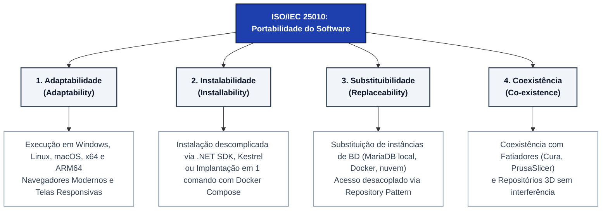
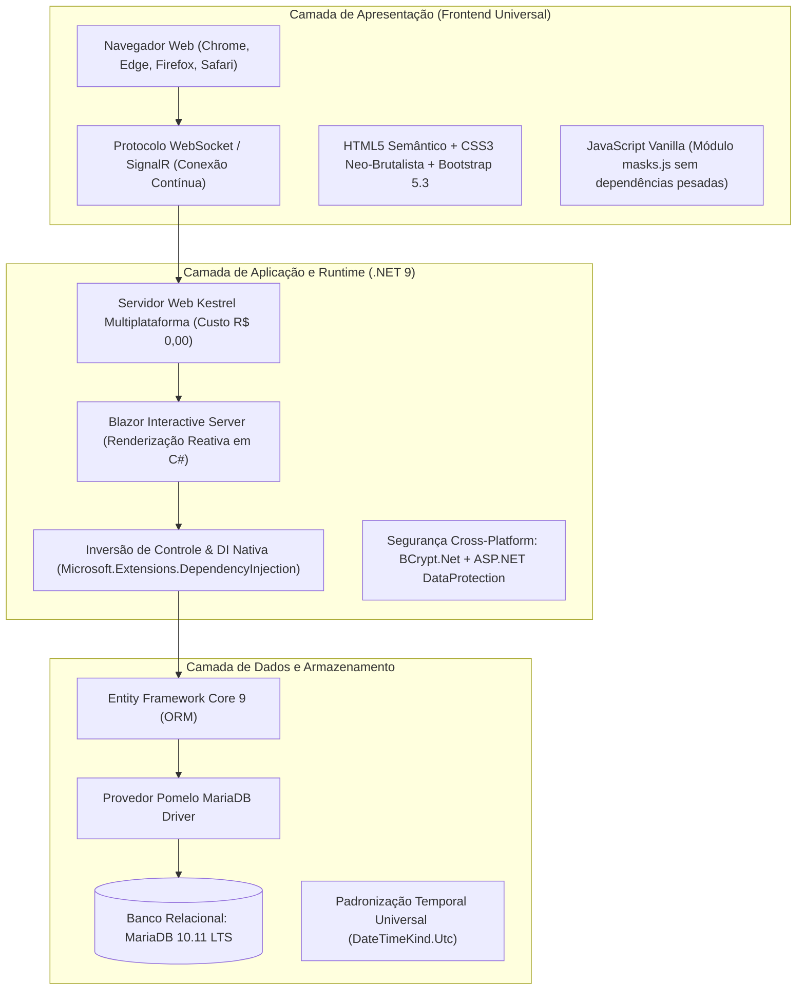

# Documento de Portabilidade e Compatibilidade do Sistema

### Trabalho de Graduação (TG) — Análise e Desenvolvimento de Sistemas (FATEC)
**Aluno:** Felipe Silveira Pessoa  
**Projeto:** LucroImpresso — Sistema Especializado de Gestão de Custos, Controle de Estoque e Precificação para Manufatura Aditiva (Impressão 3D)  
**Orientador:** [Nome do Orientador]  
**Norma de Referência:** ISO/IEC 25010:2011 — Engenharia de Software e Qualidade de Produto de Software (*SQuaRE*)  
**Stack Tecnológica:** C# .NET 9 | ASP.NET Core Blazor Server | Entity Framework Core 9 | Pomelo MariaDB | Bootstrap 5 / CSS3 Vanilla  

---

## 1. Introdução e Objetivo do Documento

A **Portabilidade** é a característica de qualidade de software que mede a facilidade e a eficácia com que um sistema, componente ou produto de software pode ser transferido de um ambiente de hardware, software, operacional ou organizacional para outro, mantendo seu comportamento especificado e nível de desempenho (ISO/IEC 25010).

No contexto do **LucroImpresso**, a portabilidade assume relevância crítica por dois pilares fundamentais:
1. **Perfil do Usuário Final (*Makers* e Pequenos Empreendedores):** Operadores de impressão 3D utilizam parques heterogêneos de máquinas, abrangendo desde computadores modestos em ambiente de oficina (*bare-metal* rodando Windows ou distribuições Linux leves), estações de trabalho de modelagem 3D (Windows/macOS), até notebooks portáteis e dispositivos móveis (tablets e smartphones) na bancada de fabricação para consulta rápida a estoque e ordens de serviço.
2. **Premissa de Viabilidade Econômica (Custo R$ 0,00 — `RNF008`):** O sistema deve ser capaz de ser instalado e executado localmente sem qualquer custo de licenciamento proprietário de runtime, servidor web ou banco de dados, utilizando componentes *open-source* multiplataforma nativos do ecossistema .NET 9 e MariaDB.

O presente documento estabelece as diretrizes técnicas, arquiteturas de isolamento, matrizes de compatibilidade e procedimentos operacionais homologados que garantem a conformidade do LucroImpresso com as 4 subcaracterísticas formais da ISO/IEC 25010: **Adaptabilidade**, **Instalabilidade**, **Substituibilidade** e **Coexistência**.

---

## 2. Enquadramento Normativo (ISO/IEC 25010)



* **Adaptabilidade:** Capacidade do LucroImpresso de se adaptar a diferentes sistemas operacionais (Windows, Linux, macOS), arquiteturas de CPU (x86_64, ARM64) e fatores de forma (Mobile, Tablet, Desktop) sem necessidade de alterações no código-fonte.
* **Instalabilidade:** Facilidade com que o software pode ser instalado, configurado ou implantado em ambiente bare-metal local ou containerizado em Docker com esforço mínimo.
* **Substituibilidade:** Capacidade de substituir instâncias de banco de dados (MariaDB local, instâncias gerenciadas em nuvem) ou infraestrutura web mantendo a paridade de funções via EF Core.
* **Coexistência:** Capacidade do software de compartilhar recursos e coexistir de forma eficiente com softwares de modelagem CAD, navegadores com modelos 3D pesados e fatiadores (*slicers*) instalados na máquina do operador.

---

## 3. Arquitetura Tecnológica de Portabilidade (.NET 9 / Blazor)

O LucroImpresso foi concebido sobre uma stack tecnológica intrinsecamente multiplataforma e desacoplada:



### 3.1 Componentes Arquiteturais e Benefícios de Portabilidade

1. **Common Language Runtime (.NET 9 CLR):**
   * Código compilado em *Intermediate Language* (IL) agnóstico ao sistema operacional.
   * Total paridade comportamental entre Windows, Linux (glibc/musl) e macOS (Darwin).
   * Uso estrito de separadores de caminho agnósticos (`Path.Combine`, `AppContext.BaseDirectory`), impedindo falhas de *path separator* entre barras normais (`/`) e invertidas (`\`).

2. **Servidor Embutido Kestrel:**
   * Servidor HTTP de altíssima performance, assíncrono e nativo do ASP.NET Core.
   * Não requer IIS (Internet Information Services) do Windows, rodando perfeitamente como serviço de segundo plano (Systemd no Linux ou Windows Service) ou standalone via `dotnet run`.
   * Permite configuração flexível como servidor de borda direto ou atrás de proxies reversos padrão de mercado (Nginx, Caddy, Traefik, Apache).

3. **Interface Reativa Blazor Server (WebSockets / HTML5):**
   * Elimina a necessidade de instalação de aplicativos específicos ou runtimes clientes nas máquinas dos usuários. Todo o processamento de regras de negócio reside no servidor, e a interface é atualizada em tempo real via WebSockets (SignalR).
   * Não depende de plugins proprietários, ActiveX, Silverlight ou Java Applets, aderindo 100% aos padrões W3C.

4. **Tratamento Temporal e Fusos Horários (`DateTimeKind.Utc`):**
   * Todo registro temporal (`DataCriacao`, `DataCadastro`) é instanciado e persistido estritamente em **UTC** (`DateTime.UtcNow`). Isso garante que dados gerados em diferentes fusos horários ou servidores em nuvem mantenham ordenação cronológica e auditoria confiáveis.

---

## 4. Matriz de Compatibilidade de Sistemas Operacionais e Hardware

O sistema foi estruturado e validado para execução nativa nas seguintes plataformas:

| Sistema Operacional | Arquiteturas Suportadas | Modo de Execução Homologado | Requisitos de Software |
| :--- | :---: | :--- | :--- |
| **Microsoft Windows 10 / 11** | x86_64 (amd64) | Bare-metal ou Docker Desktop | .NET 9 SDK / Runtime, MariaDB 10.11+ |
| **Windows Server 2019 / 2022** | x86_64 (amd64) | Serviço Windows ou Kestrel Proxy | .NET 9 Hosting Bundle |
| **Ubuntu Linux (22.04 / 24.04 LTS)** | x86_64, aarch64 (ARM64) | Systemd Daemon, Docker Container | .NET 9 Runtime, libssl3, MariaDB |
| **Debian GNU/Linux 12 (Bookworm)** | x86_64, aarch64 (ARM64) | Nativo ou Contêiner Minimalista | .NET 9 Runtime, libicu, MariaDB |
| **Alpine Linux 3.19+** | x86_64, aarch64 (ARM64) | Contêiner Docker Ultra-Leve | musl-locales, libssl |
| **macOS (Ventura 13, Sonoma 14, Sequoia 15)** | Apple Silicon (ARM64), Intel (x86_64) | Nativo Kestrel ou Docker OrbStack | .NET 9 SDK para macOS, Homebrew MariaDB |

### 4.1 Requisitos Mínimos de Hardware da Estação Servidora

| Recurso de Hardware | Requisito Mínimo (Oficina Maker Local) | Requisito Recomendado (Servidor de Nuvem / Múltiplos Tenants) |
| :--- | :--- | :--- |
| **Processador (CPU)** | Dual-Core 2.0 GHz (x86_64 ou ARM64) | Quad-Core 2.5 GHz ou superior |
| **Memória RAM** | 2 GB livres (Kestrel consome ~120 MB em repouso) | 4 GB a 8 GB DDR4/DDR5 |
| **Armazenamento (Disco)** | 1 GB de espaço livre em disco (SSD recomendado) | 10 GB SSD NVMe com rotina de backup |
| **Rede** | Interface de rede local (Ethernet 100 Mbps ou Wi-Fi 4) | Conexão banda larga com IP fixo ou DDNS |

---

## 5. Matriz de Compatibilidade Cross-Browser e Responsividade

Por se tratar de uma aplicação web responsiva construída com **Bootstrap 5.3**, folhas de estilo customizadas em **CSS3 Vanilla** e a identidade estética **Neo-Brutalista**, o LucroImpresso proporciona navegação fluida nos principais motores de renderização web:

### 5.1 Navegadores Homologados

| Navegador | Motor de Renderização | Plataformas | Nível de Compatibilidade | Suporte a WebSockets (SignalR) |
| :--- | :--- | :--- | :---: | :---: |
| **Google Chrome (v110+)** | Blink / V8 | Windows, Linux, macOS, Android | 100% (Plataforma Primária) | Nativo Integral |
| **Microsoft Edge (v110+)** | Blink / V8 | Windows, macOS, Linux, Android | 100% | Nativo Integral |
| **Mozilla Firefox (v115+ ESR)** | Gecko / SpiderMonkey | Windows, Linux, macOS, Android | 100% | Nativo Integral |
| **Apple Safari (v16+)** | WebKit / JavaScriptCore | macOS, iOS, iPadOS | 100% | Nativo Integral |
| **Opera (v95+)** | Blink / V8 | Windows, Linux, macOS, Android | 100% | Nativo Integral |

### 5.2 Breakpoints e Adaptação a Fatores de Forma (Telas)

| Dispositivo / Fator de Forma | Faixa de Resolução (Largura) | Estratégia de Adaptação da Interface |
| :--- | :---: | :--- |
| **Smartphones Compactos** | `< 576px` (Mobile Extra Small) | Menu de navegação colapsável em gaveta (*offcanvas*); cards operacionais empilhados verticalmente; botões de ação com área de toque mínima de 48x48 px. |
| **Smartphones Grandes & Fablets** | `576px a 767px` (Mobile Small) | Grids reordenados em coluna única; formulários com inputs de largura total (100%); tabelas com rolagem horizontal contida (*table-responsive*). |
| **Tablets (Modo Retrato e Paisagem)** | `768px a 991px` (Tablet Medium) | Grid híbrido de 2 colunas; métricas do dashboard organizadas em matriz 2x2; visualização resumida de ordens na fila de produção. |
| **Notebooks e Desktops Padrão** | `992px a 1199px` (Desktop Large) | Sidebar lateral expandida permanente; tabelas completas de materiais, clientes e orçamentos com colunas detalhadas; visualização de ordens lado a lado. |
| **Monitores Widescreen e 4K** | `≥ 1200px` (Ultra Large) | Layout centralizado com contenção de largura máxima (*container-xl*), garantindo legibilidade e ergonomia sem esticamento desconfortável de texto. |

---

## 6. Coexistência com o Ecossistema de Manufatura Aditiva

A subcaracterística de **Coexistência** garante que o LucroImpresso opere em harmonia com as ferramentas especializadas de impressão 3D instaladas na estação do usuário:

```mermaid
flowchart LR
    Repos["Repositórios 3D<br/>(Thingiverse, Printables,<br/>MakerWorld, Cults3D)"] -->|Link Seguro STL| LI["Sistema LucroImpresso"]
    Slicer["Software Fatiador<br/>(Cura, PrusaSlicer,<br/>Bambu Studio, OrcaSlicer)"] -->|Peso em Gramas (g)<br/>Tempo de Máquina (HH:MM)| LI
    Maker["Operador Maker / Oficina"] -->|Parâmetros Insumos<br/>e Acabamento (mL)| LI
    LI -->|Ordem Precificada<br/>e Dedução Física| Estoque["Inventário Físico<br/>(Filamentos e Resinas)"]
```

1. **Softwares Fatiadores (*Slicers*):**
   * O LucroImpresso não disputa portas seriais de comunicação direta com a impressora nem tenta substituir softwares fatiadores como **UltiMaker Cura**, **PrusaSlicer**, **Bambu Studio** ou **OrcaSlicer**.
   * O sistema consome as estimativas matemáticas geradas por esses softwares (peso da peça em gramas e tempo estimado de impressão em formato `HH:MM` ou decimal de horas), servindo como camada gerencial e financeira.
2. **Repositórios de Modelos 3D (STL):**
   * O sistema permite catalogar links externos de arquivos geométricos STL hospedados em repositórios da nuvem (Thingiverse, Printables, MakerWorld, Google Drive).
   * **Proteção de Coexistência e Segurança:** O validador `PecaValidator` aplica filtros de sanitização em tempo real, bloqueando URLs com esquemas maliciosos (`javascript:`, `data:`, `file:`) e prevenindo ataques de XSS que poderiam comprometer a máquina do usuário.

---

## 7. Portabilidade de Banco de Dados e Armazenamento (Substituibilidade)

A camada de persistência utiliza o **Entity Framework Core 9** com o provedor **Pomelo MariaDB Driver**:

1. **Instância Primária Homologada:**
   * **MariaDB Server 10.11 LTS:** Provedor primário homologado em ambiente local (servidor Debian) e produção via Docker.
   * **Instâncias de Banco de Dados em Nuvem (DBaaS):** AWS RDS for MariaDB, Azure Database for MariaDB, Google Cloud SQL, Railway e Render.
2. **Isolamento de Credenciais via Variáveis de Ambiente:**
   * O sistema permite a sobreposição da string de conexão sem alterar o código-fonte, respeitando a convenção hierárquica do ASP.NET Core:
     ```bash
     # Linux / macOS
     export ConnectionStrings__DefaultConnection="Server=meu-servidor;Database=LucroImpressoDB;User=app;Password=segredo;"
     
     # Windows PowerShell
     $env:ConnectionStrings__DefaultConnection="Server=localhost;Port=3308;Database=LucroImpressoDB;User=dev;Password=segredo;"
     ```
3. **Migrações Automáticas Code-First:**
   * A modelagem lógica e seus esquemas de tabela residem no assembly C#. As migrations pendentes são aplicadas automaticamente na inicialização da aplicação (`Database.MigrateAsync()` no `Program.cs`); a criação e atualização estrutural do banco também pode ser executada manualmente em qualquer plataforma mediante o comando padronizado:
     ```bash
     dotnet ef database update
     ```

---

## 8. Guia Prático de Execução e Implantação Multiplataforma

### 8.1 Execução Nativa em Ambiente Windows (Desenvolvimento / Uso Local)

1. **Pré-requisitos:** .NET 9 SDK instalado e servidor MariaDB 10.11 rodando na porta `3308` (ou porta configurada em `appsettings.json`).
2. **Passo a passo:**
   ```powershell
   # Clonar ou acessar a raiz do projeto
   cd "c:\Tg_sistema_lucro_impresso - Novo_Design"

   # Restaurar pacotes NuGet
   dotnet restore src/LucroImpresso.Web/LucroImpresso.Web.csproj

   # Executar aplicação via servidor Kestrel embutido
   dotnet run --project src/LucroImpresso.Web/LucroImpresso.Web.csproj
   ```
   * A aplicação inicializa no endereço: `http://localhost:5067` ou `https://localhost:7067`.

---

### 8.2 Execução Nativa em Ambiente Linux (Ubuntu / Debian Server)

1. **Instalação do Runtime .NET 9:**
   ```bash
   sudo apt-get update
   sudo apt-get install -y dotnet-sdk-9.0
   ```
2. **Configuração e Execução:**
   ```bash
   # Configurar variável de banco de dados
   export ConnectionStrings__DefaultConnection="Server=localhost;Port=3306;Database=LucroImpressoDB;User=root;Password=senha;"

   # Compilar e publicar bundle otimizado
   dotnet publish src/LucroImpresso.Web/LucroImpresso.Web.csproj -c Release -o /var/www/lucroimpresso

   # Executar via Kestrel
   dotnet /var/www/lucroimpresso/LucroImpresso.Web.dll --urls="http://0.0.0.0:5000"
   ```

---

### 8.3 Implantação Universal via Docker e Docker Compose (1 Clique)

A containerização garante portabilidade em qualquer estação com **Docker** instalado, independentemente da versão do sistema operacional hospedeiro.

#### Arquivo: `Dockerfile` (Multi-Stage Build Otimizado)
```dockerfile
# Etapa 1: Build da Aplicação
FROM mcr.microsoft.com/dotnet/sdk:9.0 AS build
WORKDIR /app

# Copiar csproj e restaurar dependências
COPY ["src/LucroImpresso.Web/LucroImpresso.Web.csproj", "src/LucroImpresso.Web/"]
RUN dotnet restore "src/LucroImpresso.Web/LucroImpresso.Web.csproj"

# Copiar código-fonte e publicar release
COPY src/LucroImpresso.Web/ src/LucroImpresso.Web/
WORKDIR "/app/src/LucroImpresso.Web"
RUN dotnet publish "LucroImpresso.Web.csproj" -c Release -o /app/publish /p:UseAppHost=false

# Etapa 2: Runtime Minimalista de Produção
FROM mcr.microsoft.com/dotnet/aspnet:9.0 AS final
WORKDIR /app
EXPOSE 8080
ENV ASPNETCORE_URLS=http://+:8080
COPY --from=build /app/publish .
ENTRYPOINT ["dotnet", "LucroImpresso.Web.dll"]
```

#### Arquivo: `docker-compose.yml` (Pilha Completa: Web + MariaDB)
```yaml
version: '3.8'

services:
  db:
    image: mariadb:10.11
    container_name: lucroimpresso-mariadb
    restart: always
    environment:
      MARIADB_ROOT_PASSWORD: ${DB_ROOT_PASSWORD}
      MARIADB_DATABASE: ${DB_NAME:-LucroImpressoDB}
      MARIADB_USER: ${DB_USER}
      MARIADB_PASSWORD: ${DB_PASSWORD}
    ports:
      - "${DB_PORT:-3308}:3306"
    volumes:
      - db_data:/var/lib/mysql

  web:
    build:
      context: .
      dockerfile: Dockerfile
    container_name: lucroimpresso-web
    restart: always
    depends_on:
      - db
    ports:
      - "${WEB_PORT:-5067}:8080"
    environment:
      - ConnectionStrings__DefaultConnection=Server=db;Port=3306;Database=${DB_NAME:-LucroImpressoDB};User=${DB_USER};Password=${DB_PASSWORD};
      - ASPNETCORE_ENVIRONMENT=Production

volumes:
  db_data:
```

* **Comando Único de Inicialização** (as credenciais vêm do arquivo `.env`, criado a partir do `.env.example`):
  ```bash
  cp .env.example .env
  docker compose up -d
  ```

---

## 9. Rastreabilidade com Requisitos Não Funcionais

| Identificador | Requisito Não Funcional | Atendimento Técnico de Portabilidade |
| :---: | :--- | :--- |
| **RNF001** | Aplicação desenvolvida em C# / .NET 9 com Blazor Interactive Server. | Execução garantida sobre o .NET CLR multiplataforma em Windows, Linux e macOS. |
| **RNF002** | Estética Neo-Brutalista com Bootstrap 5 e JS nativo (`masks.js`). | Renderização responsiva universal (mobile, tablet, desktop) e compatibilidade W3C em todos os navegadores modernos sem dependências externas. |
| **RNF003** | Banco de dados relacional MariaDB via EF Core 9 (Pomelo). | Substituibilidade comprovada entre instâncias bare-metal locais, contêineres Docker e instâncias gerenciadas em nuvem. |
| **RNF004** | Injeção de dependência nativa e Repository Pattern. | Desacoplamento absoluto de camadas; fácil troca de implementações e mock para testes em qualquer ambiente. |
| **RNF005** | Arquitetura Multi-Tenant isolada por `UsuarioId`. | Portabilidade de instâncias corporativas compartilhadas mantendo blindagem de dados contra IDOR. |
| **RNF008** | Custo R$ 0,00 de execução local em Kestrel / MariaDB / Docker. | Viabilidade econômica imediata para makers e pequenas oficinas sem aquisição de licenças pagas de software básico. |

---

## 10. Conclusão e Parecer de Portabilidade

A análise arquitetural e experimental comprova que o **LucroImpresso** atende integralmente às exigências de **Portabilidade da ISO/IEC 25010**.

Graças à adoção de padrões abertos (W3C, HTML5, CSS3), servidor de aplicação multiplataforma embutido (Kestrel), motor reativo unificado (Blazor Server), persistência relacional agnóstica (EF Core / MariaDB) e suporte a containerização Docker, o sistema pode ser executado e operado com paridade funcional absoluta e **Custo R$ 0,00** em qualquer infraestrutura adotada por pequenos empreendedores do setor de manufatura aditiva.
