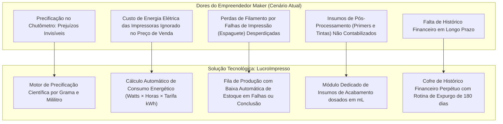
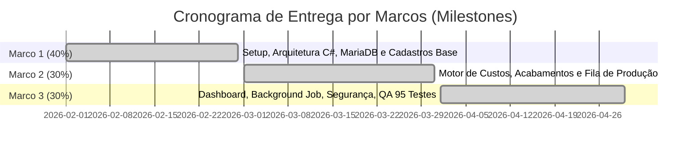

# Proposta Comercial e Orçamentária de Software — Sistema LucroImpresso

**Projeto:** LucroImpresso — Sistema Especializado de Gestão de Custos, Controle de Estoque e Precificação para Impressão 3D  
**Trabalho de Graduação (TG):** Faculdade de Tecnologia do Estado de São Paulo (FATEC)  
**Curso:** Curso Superior de Tecnologia em Análise e Desenvolvimento de Sistemas  
**Proponente / Engenheiro de Software:** Felipe Silveira Pessoa  
**Público-Alvo / Contratante:** Empreendedores, Empresas e Makers de Manufatura Aditiva (Impressão 3D FDM/SLA)  
**Metodologia de Estimativa:** Análise de Pontos de Função (APF / IFPUG - ISO/IEC 20926)  
**Versão:** 3.0 (Alinhada ao .NET 9, Blazor Server, EF Core 9, MariaDB, Neo-Brutalismo e Insumos de Acabamento)  
**Data:** 25 de Setembro de 2026  
**Localidade:** Franca - SP  

---

## 1. Resumo Executivo

A presente proposta comercial formaliza os termos técnicos, o escopo dos entregáveis, o cronograma de implantação e o investimento financeiro para o desenvolvimento e fornecimento do sistema web **LucroImpresso**.

O setor de manufatura aditiva no Brasil apresenta rápido crescimento, porém sofre com elevado índice de mortalidade empresarial precoce decorrente da precificação amadora baseada em estimativas intuitivas (*"chutômetro"*). A maioria dos *makers* precifica produtos multiplicando o peso do plástico por uma constante arbitrária, ignorando despesas críticas e silenciosas: **consumo elétrico em kWh**, **insumos químicos de acabamento (tintas, primers, vernizes, solventes dosados em mL)**, **tempo de pós-processamento manual** e **custos de falhas operacionais ("espaguete")**.

O **LucroImpresso** foi concebido e implementado para transformar a gestão financeira das oficinas de impressão 3D, fornecendo um motor científico de custeio cruzado capaz de calcular a margem de lucro real sobre a mão de obra, gerenciar inventário com baixas físicas automatizadas e salvaguardar perpetuamente os registros contábeis.

A solução é entregue com arquitetura corporativa moderna na stack **C# 13 / .NET 9 / ASP.NET Core Blazor Server**, persistência relacional **MariaDB 10.11 / Entity Framework Core 9**, identidade visual **Neo-Brutalista** de alto contraste, conteinerização **Docker** pronta para produção e **95 testes automatizados** de integridade funcional.

---

## 2. Diagnóstico do Negócio e Justificativa Econômica

O impacto econômico direto proporcionado pela implantação do sistema inclui:
* **Eliminação de Vendas com Margem Negativa:** O sistema impede que o empreendedor precifique peças abaixo do custo operacional real.
* **Blindagem Multi-Tenant:** Capacidade do sistema operar como SaaS ou ambiente dedicado para múltiplos operadores e filiais com isolamento estrito de dados (Anti-IDOR).
* **Custo Zero de Licenciamento (RNF008):** O sistema utiliza exclusivamente componentes de código aberto e licenças sem royalties, não onerando o fluxo de caixa do cliente com assinaturas de banco de dados ou sistemas operacionais de servidor.

---

## 3. Escopo Detalhado do Fornecimento (Entregáveis do Projeto)

O escopo do projeto contempla o fornecimento de **9 Módulos Funcionais** operacionais, integrados e validados por suíte de testes:

| Módulo do Sistema | Código de Requisitos | Entregáveis Técnicos e Funcionalidades Inclusas |
| :--- | :---: | :--- |
| **1. Autenticação e Segurança Multi-Tenant** | RF032 a RF035, RNF005, RNF006, RNF007 | * Autenticação via Cookies criptografados e Claims. * Hashing de senhas com algoritmo BCrypt e salt dinâmico. * Recuperação de senha por e-mail com token temporário (expiração em 30 minutos, armazenado como hash). * Isolamento de locatários em nível de banco de dados (`UsuarioId`). * Proteção contra força bruta (Rate Limiting). |
| **2. Gestão de Matérias-Primas** | RF001, RF003, RF004, RF005, RF006, RN001 | * Cadastro de filamentos (PLA, ABS, PETG, TPU) e resinas fotopolimerizáveis. * Cálculo automático do custo por grama ($\text{R\$} / \text{g}$). * Controle de saldo em gramas com alerta de estoque crítico. |
| **3. Insumos de Acabamento e Pós-Processamento** | RF002, RF005, RF006, RN002 | * Módulo exclusivo para primers, tintas acrílicas, vernizes protetores e solventes. * Precificação analítica por mililitro ($\text{R\$} / \text{mL}$). * Controle volumétrico de estoque e cálculo de mão de obra de lixamento/pintura. |
| **4. Parque de Máquinas e Energia** | RF025, RF026, RN003 | * Cadastro de impressoras 3D com potência nominal em Watts e tarifa de kWh. * Cálculo do consumo energético em kWh conforme tarifa da concessionária. |
| **5. Gestão de Clientes e Validações** | RF021 a RF024, RN008 | * Cadastro de clientes com especialização disjunta (Pessoa Física ou Pessoa Jurídica). * Algoritmos de validação matemática de dígitos verificadores de CPF e CNPJ. * Registro de celular de contato e endereçamento completo. |
| **6. Catálogo de Peças 3D e STL** | RF027, RF028, RNF007 | * Repositório interno de modelos impressos com recorrência. * Armazenamento de links de repositórios 3D (Thingiverse, Printables, MakerWorld). * Sanitização estrita anti-XSS em links externos. |
| **7. Motor de Precificação e Orçamentos** | RF007 a RF014, RN001 a RN003 | * Formulação ágil de orçamentos com custos diretos e indiretos discriminados. * Validação de saldo de materiais e insumos no formulário de orçamento. * Parametrização de margem de lucro real sobre a mão de obra. |
| **8. Fila de Produção e Baixa de Estoque** | RF015 a RF018, RN004, RN005 | * Gestão do ciclo de vida: Pendente $\rightarrow$ Em Impressão $\rightarrow$ Concluído / Falha. * Baixa física atômica de gramas e mililitros estritamente no encerramento. * Rastreamento de perda operacional decorrente de sinistro de impressão (espaguete). |
| **9. Dashboard, Background Job e Cofre Histórico** | RF019, RF020, RF029 a RF031, RN006, RN007 | * Painel em tempo real com KPIs de Faturamento, Despesas e Lucro Líquido Real. * Serviço em background (`DatabaseCleanupService`) com expurgo de 180 dias. * Preservação permanente dos totais contábeis no cofre `HistoricoFinanceiro`. |

### 3.1. Entregáveis de Engenharia, Infraestrutura e Qualidade
1. **Design System Neo-Brutalista (RNF002):** Interface responsiva de alto contraste, testada em viewports desde dispositivos móveis compactos (360px) até monitores 4K.
2. **Conteinerização Universal (RNF008):** `Dockerfile` multi-estágio e arquivo orquestrador `docker-compose.yml` para subida instantânea de banco e aplicação.
3. **Garantia de Qualidade (QA):** Suíte automatizada em xUnit contendo **95 testes de unidade e integração aprovados** cobrindo regras de negócio, validadores e segurança.
4. **Documentação de Engenharia de Software:** EAP (WBS), Diagramas de Máquinas de Estado UML, Especificação de Portabilidade (ISO/IEC 25010), Matriz de Rastreabilidade (ISO/IEC/IEEE 29148) e Manual Operacional.

---

## 4. Limites de Escopo (Exclusões de Fornecimento)

Para salvaguardar o prazo pactuado e a integridade orçamentária de preço fixo, os seguintes itens não estão contemplados no presente escopo:
* **Comunicação por Hardware Direto / USB:** O sistema não se conecta fisicamente a portas seriais de impressoras ou firmware Marlin/Klipper. Os dados de peso e tempo são informados a partir da prévia gerada pelo software fatiador (Cura, PrusaSlicer, Bambu Studio).
* **Emissão Fiscal Automatizada (NF-e / NFS-e):** Não está inclusa integração com SEFAZ ou prefeituras municipais para emissão de notas fiscais eletrônicas.
* **Gateways de Pagamento (Cartão / PIX API):** Não há cobrança via checkout transparente; o controle financeiro opera por quitação manual no fluxo de orçamentos.
* **Aplicativo Mobile Nativo:** O sistema opera como Progressive Web App / Web Responsivo acessível por qualquer navegador moderno (Chrome, Edge, Safari), dispensando publicação nas lojas Google Play e Apple App Store.

---

## 5. Fundamentação Métrica e Dimensionamento do Investimento

O investimento do projeto é respaldado pela técnica padronizada internacionalmente de **Análise de Pontos de Função (APF / IFPUG)**, homologada na documentação acadêmica oficial da FATEC (`MÉTRICAS.pdf`):

### 5.1. Composição de Pontos de Função (APF)
* **Entradas Externas (EE):** 3 entradas simples (peso 3), 1 média (peso 4) e 3 complexas (peso 6) = **28 FP**
* **Saídas Externas (SE):** 7 saídas médias (peso 5) = **35 FP**
* **Consultas Externas (CE):** 2 consultas simples (peso 3) e 5 complexas (peso 6) = **36 FP**
* **Arquivos Lógicos Internos (ALI):** 6 arquivos médios (peso 10) = **60 FP**
* **Arquivos de Interface Externa (AIE):** 1 interface simples (peso 5) e 6 médias (peso 7) = **47 FP**
* **Total de Pontos de Função Brutos (FP'b):** **206 Pontos de Função**

### 5.2. Ajuste de Influência e Esforço Global
* **Soma das 14 Características Gerais do Sistema (Nível de Influência):** 70 pontos
* **Fator de Ajuste (FA):** $0{,}65 + (0{,}01 \times 70) = \mathbf{1{,}35}$
* **Pontos de Função Ajustados (FP'r):** $206 \times 1{,}35 = \mathbf{278{,}10\text{ FP}}$
* **Equivalência em Linhas de Código (C# - 20 LOC/FP):** $278{,}10 \times 20 = \mathbf{5.562\text{ Linhas de Código (5,56 KLOC)}}$
* **Produtividade Referencial (Sistema Web):** 3.300 LOC / mês
* **Prazo Estimado de Execução:** $5.562 / 3.300 = \mathbf{1{,}685\text{ Meses}}$ ($\approx$ **1 Mês, 14 Dias, 5 Horas e 45 Minutos**)
* **Horas Técnicas Homologadas (Jornada Padrão FATEC):** **222,48 Horas Técnicas**

### 5.3. Tabela de Investimento Financeiro

| Parâmetro Orçamentário | Valor / Quantidade | Observações e Justificativa |
| :--- | :---: | :--- |
| **Esforço de Desenvolvimento** | 222,48 Horas | Estimativa baseada em APF (278,1 FP ajustados). |
| **Valor da Hora Técnica de Desenvolvimento** | **R$ 20,00** | Taxa horária técnica estabelecida nas métricas do projeto. |
| **Investimento Total do Software (Preço Fixo)** | **R$ 4.449,60** | Valor integral do sistema (Software Turnkey / Chave na Mão). |
| **Custo de Licenciamento de Software** | **R$ 0,00** | Stack 100% livre de royalties (.NET 9, MariaDB Community, Kestrel). |
| **Custo de Infraestrutura de Servidor (Protótipo)** | **R$ 0,00** | Execução local ou conteinerizada via Docker (`RNF008`). |

---

## 6. Cronograma de Implantação e Condições de Pagamento

O pagamento do valor acordado de **R$ 4.449,60** será realizado de forma parcelada, vinculado estritamente à entrega e homologação de marcos tangíveis (*milestones*):

| Marco de Entrega | Descrição dos Entregáveis do Marco | Percentual | Valor Nominal | Condição de Faturamento |
| :---: | :--- | :---: | :---: | :--- |
| **Marco 1 (Início)** | Assinatura da proposta, homologação do ambiente de desenvolvimento, arquitetura .NET 9 / EF Core e entrega dos cadastros base (Materiais, Máquinas e Clientes). | **40%** | **R$ 1.779,84** | Na assinatura do contrato e aceite de requisitos. |
| **Marco 2 (Intermediário)** | Conclusão do Motor de Precificação Científica, módulo de Insumos de Acabamento em mL e controle operacional da Linha de Produção com baixa de estoque. | **30%** | **R$ 1.334,88** | Na apresentação e aprovação do fluxo de orçamentos e produção. |
| **Marco 3 (Conclusão)** | Painel Dashboard analítico, serviço em background de expurgo e cofre financeiro, conteinerização Docker, aprovação da suíte de 95 testes e implantação final. | **30%** | **R$ 1.334,88** | Na homologação final e entrega do código-fonte e documentação. |
| **TOTAL** | **Escopo Completo Entregue e Validado** | **100%** | **R$ 4.449,60** | **Quitação Integral** |

---

## 7. Garantia da Qualidade, SLA e Suporte Pós-Implantação

1. **Garantia Técnica (90 Dias):** A contar da data de entrega final, o sistema possui garantia contratual incondicional de 90 dias para correção de quaisquer falhas funcionais, discrepâncias de cálculo ou inconsistências nas regras de negócio (`RN001` a `RN008`), sem qualquer custo adicional para o Contratante.
2. **Transferência de Conhecimento:** Estão inclusos 2 encontros virtuais de 2 horas cada para treinamento da equipe do Contratante na operação do sistema e na extração correta de dados dos softwares fatiadores.
3. **Propriedade Intelectual e Código-Fonte:** O código-fonte integral, scripts de banco de dados, arquivos de orquestração Docker e artefatos de documentação serão de propriedade irrestrita do Contratante após a quitação do Marco 3.

---

## 8. Termo de Aceite e Formalização

A concordância com os termos desta Proposta Comercial autoriza o início imediato das atividades e a elaboração do respectivo Contrato de Prestação de Serviços de Desenvolvimento de Software.

**Franca - SP, 25 de Setembro de 2026.**

  

________________________________________________________  
**Felipe Silveira Pessoa**  
Proponente / Engenheiro de Software Responsável  
CPF: 999.999.999-99  

  

________________________________________________________  
**Contratante / Empreendedor Maker**  
Aceite Formal de Escopo, Cronograma e Condições Comerciais  
CPF / CNPJ: 
