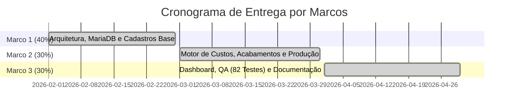

# Termo de Abertura do Projeto (TAP) — Sistema LucroImpresso

**Projeto:** LucroImpresso — Sistema Especializado de Gestão de Custos, Controle de Estoque e Precificação para Manufatura Aditiva (Impressão 3D)  
**Trabalho de Graduação (TG):** Faculdade de Tecnologia do Estado de São Paulo (FATEC)  
**Curso:** Curso Superior de Tecnologia em Análise e Desenvolvimento de Sistemas  
**Aluno / Gerente do Projeto:** Felipe Silveira Pessoa  
**Orientador:** [Nome do Orientador]  
**Versão:** 3.0 (Alinhada à implementação final entregue)  
**Data:** 25 de Setembro de 2026  
**Localidade:** Franca - SP  

---

## 1. Justificativa do Projeto

O setor de manufatura aditiva (impressão 3D) no Brasil apresenta crescimento acelerado, porém sofre com elevado índice de mortalidade empresarial precoce. A principal causa é a **precificação amadora** baseada em estimativas intuitivas ("chutômetro"), na qual os empreendedores multiplicam o peso do plástico por uma constante arbitrária, ignorando despesas críticas como:

- **Custo de energia elétrica** das impressoras (Watts × horas × tarifa kWh);
- **Insumos químicos de acabamento** (tintas, primers, vernizes, solventes dosados em mL);
- **Tempo de mão de obra** em pós-processamento (lixamento, pintura, verniz);
- **Perdas por falhas operacionais** ("espaguete", descolamento, bico entupido).

O **LucroImpresso** foi concebido para resolver esse problema fornecendo uma ferramenta científica de custeio cruzado para o empreendedor maker.

---

## 2. Objetivos do Projeto

### 2.1 Objetivo Geral
Desenvolver e entregar um sistema web completo de gestão de custos, controle de estoque e precificação científica para oficinas de impressão 3D, utilizando arquitetura corporativa moderna e stack 100% open-source.

### 2.2 Objetivos Específicos
1. Implementar um motor de precificação que calcule custos reais por grama (filamentos) e por mililitro (insumos de acabamento);
2. Automatizar o cálculo de consumo energético com base na potência da impressora (Watts), tempo de impressão e tarifa de kWh;
3. Gerenciar o ciclo de vida completo de orçamentos: Pendente → Em Impressão → Concluído / Falha;
4. Executar baixa física atômica de estoque (gramas e mL) no encerramento de produção;
5. Preservar histórico contábil perpétuo via cofre acumulador (`HistoricoFinanceiro`);
6. Garantir isolamento Multi-Tenant estrito (Anti-IDOR) por `UsuarioId`;
7. Validar a integridade do sistema com suíte de 82 testes automatizados (xUnit).

---

## 3. Escopo do Projeto

### 3.1 Entregas Inclusas (In-Scope)

| # | Módulo / Entregável | Descrição |
| :---: | :--- | :--- |
| 1 | **Autenticação e Segurança** | Login/Cadastro com Cookies seguros, BCrypt, recuperação por e-mail com token de 2h, Rate Limiting, sanitização XSS. |
| 2 | **Gestão de Matérias-Primas** | CRUD de filamentos e resinas com cálculo automático de custo por grama (RN001). |
| 3 | **Insumos de Acabamento** | CRUD de tintas, primers, vernizes e solventes com precificação por mL (RN002). |
| 4 | **Parque de Máquinas e Energia** | CRUD de impressoras 3D com potência (Watts) e tarifa de kWh. Cálculo de energia (RN003). |
| 5 | **Gestão de Clientes** | Cadastro PF/PJ com herança disjunta, validação de CPF/CNPJ e endereço completo. |
| 6 | **Catálogo de Peças 3D** | Repositório de modelos recorrentes com links STL sanitizados (anti-XSS). |
| 7 | **Motor de Precificação** | Formulário de orçamentos com custos diretos discriminados e margem de lucro real. |
| 8 | **Fila de Produção** | Gestão de ciclo de vida com baixa de estoque em Concluído/Falha (RN004). |
| 9 | **Dashboard e Cofre Histórico** | KPIs em tempo real, Background Job de expurgo de 180 dias (RN006), cofre perpétuo (RN007). |
| 10 | **Documentação de Engenharia** | EAP, Diagramas UML, Matriz de Rastreabilidade (ISO 29148), Portabilidade (ISO 25010), Proposta Comercial (APF). |
| 11 | **Suíte de Testes (QA)** | 82 testes unitários e de integração em xUnit cobrindo validadores, máquina de estados e segurança. |
| 12 | **Conteinerização Docker** | Dockerfile multi-estágio e docker-compose.yml para implantação com 1 comando. |

### 3.2 Exclusões de Escopo (Out-of-Scope)
- Comunicação direta com impressoras via USB/Serial (Marlin/Klipper);
- Emissão fiscal automatizada (NF-e / NFS-e);
- Gateways de pagamento (PIX API, cartão);
- Aplicativo mobile nativo (Google Play / App Store).

---

## 4. Stack Tecnológica Implementada

| Camada | Tecnologia | Versão |
| :--- | :--- | :---: |
| **Runtime** | .NET | 9.0 |
| **Linguagem** | C# | 13 |
| **Framework Web** | ASP.NET Core Blazor Interactive Server | 9.0 |
| **ORM** | Entity Framework Core (Code-First) | 9.0 |
| **Banco de Dados** | MariaDB (via Pomelo MariaDB Driver) | 10.11 LTS |
| **Validação** | FluentValidation | 12.x |
| **Hashing** | BCrypt.Net-Next | 4.1.0 |
| **E-mail** | MailKit | 4.17.0 |
| **Sanitização** | HtmlSanitizer (Ganss.Xss) | 9.x |
| **Logging** | Serilog | 10.x |
| **Segurança HTTP** | NetEscapades.AspNetCore.SecurityHeaders | 1.3.1 |
| **Testes** | xUnit + FluentValidation | — |
| **Contêineres** | Docker + Docker Compose | — |
| **Estilização** | Bootstrap 5 + CSS3 Vanilla (Neo-Brutalismo) | 5.3 |
| **Servidor Web** | Kestrel (embutido no .NET) | 9.0 |

---

## 5. Requisitos de Alto Nível

| Categoria | Quantidade | Faixa de Identificação |
| :--- | :---: | :---: |
| **Requisitos Funcionais** | 35 | RF001 a RF035 |
| **Requisitos Não-Funcionais** | 8 | RNF001 a RNF008 |
| **Regras de Negócio** | 8 | RN001 a RN008 |
| **Casos de Uso** | 28 | UC01 a UC28 |
| **Testes Automatizados** | 82 | 4 classes xUnit |

### 5.1 Regras de Negócio Implementadas

| RN | Descrição |
| :---: | :--- |
| **RN001** | Custo do material calculado por grama (Preço / Peso). |
| **RN002** | Insumos de acabamento precificados por mililitro (Preço / Volume). |
| **RN003** | Energia elétrica = (Watts / 1000) × Horas × Tarifa kWh. |
| **RN004** | Baixa física de estoque restrita a transição para "Concluído" ou "Falha". |
| **RN005** | Exclusões e desfechos críticos exigem confirmação explícita em modal. |
| **RN006** | Expurgo automático diário de orçamentos inativos há mais de 180 dias. |
| **RN007** | Preservação contábil perpétua no cofre acumulador `HistoricoFinanceiro`. |
| **RN008** | Isolamento Multi-Tenant estrito (Anti-IDOR) por `UsuarioId`. |

---

## 6. Premissas

1. O ambiente de desenvolvimento e produção utiliza .NET 9 SDK e MariaDB 10.11;
2. O servidor de produção opera em Debian Linux com MariaDB instalado localmente;
3. Os dados de peso (g) e tempo de impressão (HH:MM) são informados pelo operador a partir do software fatiador (Cura, PrusaSlicer, Bambu Studio);
4. O sistema não se conecta diretamente às impressoras 3D;
5. O custo de licenciamento de software é R$ 0,00 (stack 100% open-source).

---

## 7. Restrições

1. O sistema opera exclusivamente como aplicação web acessível por navegador moderno com suporte a WebSockets (SignalR);
2. A baixa de estoque é executada na camada de visão (`Producao.razor`), não em transação de banco de dados;
3. O expurgo automático apaga orçamentos pela data de criação, independentemente do status;
4. O `UpdateAsync` do repositório de orçamentos não filtra por `UsuarioId` na busca (proteção parcial Anti-IDOR);
5. O prazo de entrega está vinculado ao calendário acadêmico da FATEC.

---

## 8. Riscos Identificados

| # | Risco | Probabilidade | Impacto | Mitigação |
| :---: | :--- | :---: | :---: | :--- |
| 1 | Indisponibilidade do servidor MariaDB no Debian | Baixa | Alto | Docker Compose como backup; documentação de restauração. |
| 2 | Perda de dados por expurgo indevido | Baixa | Alto | Cofre `HistoricoFinanceiro` preserva totais contábeis antes do expurgo. |
| 3 | Falha na baixa de estoque (operações não transacionais) | Média | Médio | Limitação documentada; baixa executada item a item com clamp em zero. |
| 4 | Atraso no cronograma acadêmico | Média | Alto | Metodologia iterativa com marcos de entrega parciais. |

---

## 9. Cronograma de Marcos

| Marco | Entregáveis | Percentual | Status |
| :---: | :--- | :---: | :---: |
| **Marco 1** | Arquitetura .NET 9 / EF Core, MariaDB, cadastros de Materiais, Máquinas e Clientes | 40% | ✅ Concluído |
| **Marco 2** | Motor de Precificação, módulo de Acabamentos (mL), Fila de Produção com baixa de estoque | 30% | ✅ Concluído |
| **Marco 3** | Dashboard analítico, Background Job (expurgo 180 dias), suíte de 82 testes, Docker, documentação | 30% | ✅ Concluído |

---

## 10. Orçamento e Investimento

| Parâmetro | Valor |
| :--- | :---: |
| **Horas Técnicas (APF)** | 222,48 h |
| **Valor da Hora Técnica** | R$ 20,00 |
| **Investimento Total (Preço Fixo)** | **R$ 4.449,60** |
| **Custo de Licenciamento** | R$ 0,00 |
| **Custo de Infraestrutura (Protótipo)** | R$ 0,00 |

---

## 11. Partes Interessadas (Stakeholders)

| Stakeholder | Papel | Responsabilidade |
| :--- | :--- | :--- |
| **Felipe Silveira Pessoa** | Aluno / Engenheiro de Software | Desenvolvimento, testes, documentação e apresentação do TG. |
| **[Nome do Orientador]** | Orientador Acadêmico | Orientação técnica e metodológica durante o desenvolvimento. |
| **Banca Examinadora (FATEC)** | Avaliadores | Avaliação formal do sistema, documentação e defesa do TG. |
| **Empreendedores Makers** | Usuários Finais | Utilização do sistema para precificação e gestão de custos. |

---

## 12. Critérios de Aceitação

1. Todos os 35 Requisitos Funcionais (RF001 a RF035) implementados e operacionais;
2. Todas as 8 Regras de Negócio (RN001 a RN008) aplicadas e rastreáveis no código-fonte;
3. Suíte de 82 testes automatizados aprovados com 0 falhas (`dotnet test`);
4. Sistema executável via `dotnet run` (bare-metal) ou `docker compose up -d` (contêiner);
5. Documentação de engenharia completa: EAP, Máquina de Estados, Portabilidade (ISO 25010), Matriz de Rastreabilidade (ISO 29148), Proposta Comercial (APF);
6. Isolamento Multi-Tenant (Anti-IDOR) validado por testes automatizados;
7. Custo total de licenciamento de software: R$ 0,00.

---

## 13. Aprovação

| Papel | Nome | Assinatura | Data |
| :--- | :--- | :--- | :---: |
| **Aluno / Gerente do Projeto** | Felipe Silveira Pessoa | __________________________ | ___/___/2026 |
| **Orientador Acadêmico** | [Nome do Orientador] | __________________________ | ___/___/2026 |
